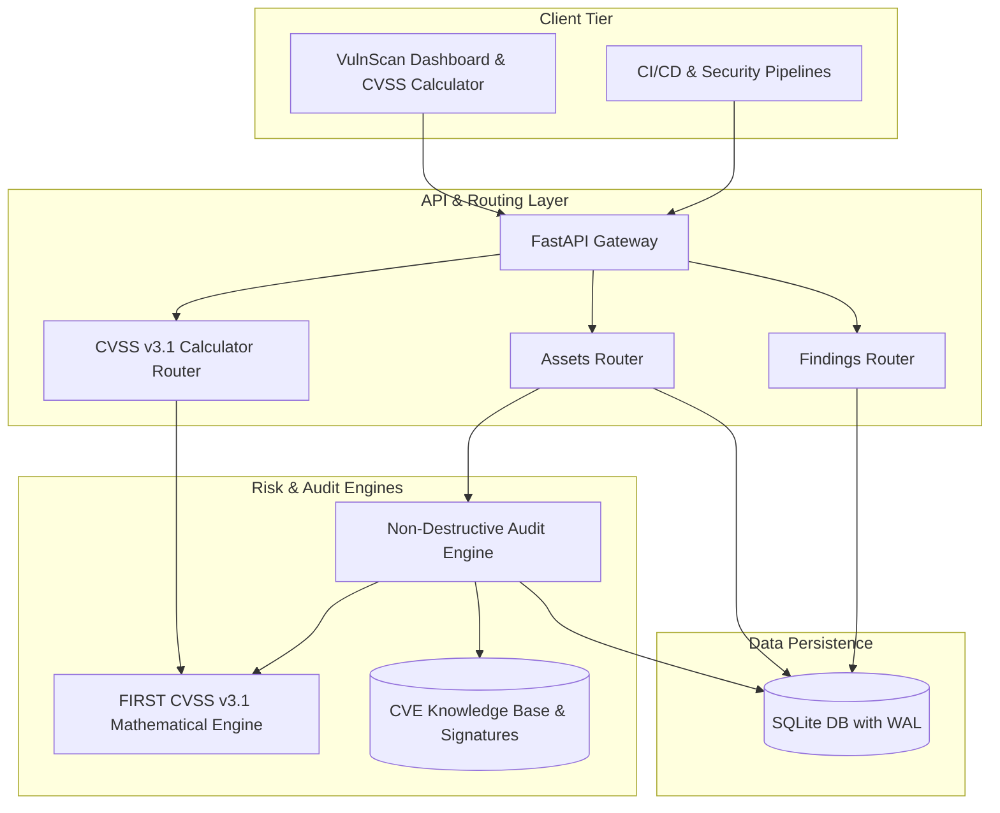

# VulnScan — Authorized Asset Vulnerability Assessment Tool & CVSS v3.1 Engine

[](https://github.com/Soulofghost/vulnscan/actions)
[](LICENSE)
[](https://www.python.org/)
[](https://fastapi.tiangolo.com/)
[](https://www.first.org/cvss/v3.1/specification-document)

VulnScan is a production-oriented vulnerability assessment and asset risk management platform engineered strictly for authorized systems and defensive auditing. It performs non-destructive service discovery, calculates Common Vulnerability Scoring System (CVSS v3.1) vectors, correlates open exposures with known CVE signatures, and tracks remediation lifecycles alongside automated mitigation playbooks.

---

## 1. Project Introduction

VulnScan enables security engineers, DevSecOps practitioners, and infrastructure administrators to maintain continuous vulnerability oversight across internal assets, staging environments, and production clusters. It couples an exact mathematical implementation of the FIRST CVSS v3.1 standard with a non-destructive audit engine and an intuitive remediation tracking interface.

---

## 2. Problem Statement

Organizations struggle with fragmented vulnerability management pipelines:
- **Discrepancies in CVSS Calculations:** Teams frequently miscalculate base, impact, and exploitability scores due to inaccurate manual formulas or third-party variations.
- **Disconnected Asset Context:** Generic scanners produce isolated vulnerability dumps lacking environment metadata (Production vs. Staging vs. Internal) and criticality tiering.
- **Absence of Actionable Remediation:** Security reports identify CVE numbers without delivering copy-paste mitigation playbooks and patching guidance.
- **Destructive Scanner Risks:** Unchecked aggressive scanners risk destabilizing sensitive production microservices.

---

## 3. Proposed Solution

VulnScan provides a unified, safe, and standards-compliant framework:
1. **Mathematical CVSS v3.1 Engine:** Full adherence to the FIRST standard specification, correctly computing Impact Sub-Scores, Exploitability Sub-Scores, Scope transitions, and Ceiling roundup arithmetic.
2. **Authorized Asset Registry:** Maintains a catalog of monitored target hosts, environment tags, port allocations, and asset criticality tiers.
3. **Safe Signature Audit Engine:** Correlates target service banners and ports against validated CVE definitions without launching invasive exploit payloads.
4. **Remediation Lifecycle Workflow:** Empowers analysts to advance vulnerabilities from `UNREMEDIATED` to `PATCH_APPLIED` and `VERIFIED`, recalculating fleet posture scores dynamically.

---

## 4. Key Features

- **CVSS v3.1 Vector Engine:** Full support for Base Metric calculations (`AV`, `AC`, `PR`, `UI`, `S`, `C`, `I`, `A`) with real-time vector string generation.
- **Interactive Web Calculator:** Real-time GUI for adjusting CVSS parameters and visualizing sub-score impacts immediately.
- **Authorized Target Inventory:** Register and categorize internal and cloud infrastructure targets with port bindings.
- **Remediation Playbook Integration:** Step-by-step containment instructions, package upgrades, and configuration hardening commands for every finding.
- **Posture Health Score:** Dynamic organizational security index (0–100) reflecting active critical exposures, high-risk assets, and verified mitigations.
- **Zero Heavy Agents:** Lightweight FastAPI backend running on SQLite WAL with fast startup and low resource consumption.

---

## 5. Architecture Diagram



---

## 6. Technology Stack

- **Backend:** Python 3.11+, FastAPI, Pydantic v2
- **Scoring Engine:** Mathematical FIRST CVSS v3.1 implementation
- **Database:** SQLite with Write-Ahead Logging (WAL)
- **Frontend:** HTML5, Modern CSS3 with Space Grotesk & JetBrains Mono, Vanilla ES6+ JavaScript
- **DevOps:** Docker, Docker Compose, GitHub Actions CI
- **Testing:** Pytest, HTTPX TestClient

---

## 7. Folder Structure

```
vulnscan/
├── .github/
│   └── workflows/
│       └── ci.yml
├── backend/
│   ├── app/
│   │   ├── engine/
│   │   │   ├── __init__.py
│   │   │   ├── cvss.py
│   │   │   └── scanner.py
│   │   ├── routers/
│   │   │   ├── __init__.py
│   │   │   ├── assets.py
│   │   │   ├── cvss.py
│   │   │   └── findings.py
│   │   ├── __init__.py
│   │   ├── config.py
│   │   ├── database.py
│   │   ├── main.py
│   │   └── schemas.py
│   ├── tests/
│   │   ├── __init__.py
│   │   ├── test_api.py
│   │   └── test_cvss.py
│   └── requirements.txt
├── frontend/
│   ├── app.js
│   ├── index.html
│   └── style.css
├── .env.example
├── .gitignore
├── Dockerfile
├── docker-compose.yml
├── LICENSE
└── README.md
```

---

## 8. Installation Instructions

### Prerequisites
- Python 3.11 or later
- Git

### Setup Steps
```bash
# Clone the repository
git clone https://github.com/Soulofghost/vulnscan.git
cd vulnscan

# Setup virtual environment
python -m venv venv
source venv/bin/activate  # On Windows: .\venv\Scripts\activate

# Install requirements
pip install -r backend/requirements.txt
```

---

## 9. Environment Configuration

Copy `.env.example` to `.env`:
```bash
cp .env.example .env
```

| Variable | Default | Description |
|---|---|---|
| `PORT` | `8000` | Application HTTP port |
| `VULNSCAN_DB` | `vulnscan.db` | SQLite database file path |
| `AUTH_MODE` | `AUTHORIZED_SYSTEMS_ONLY` | Safety and governance policy flag |

---

## 10. Database Setup

Database initialization and default asset seeding run automatically on application startup. To trigger schema creation programmatically:
```bash
python -c "from app.database import init_db; init_db()"
```

---

## 11. API Documentation

### Key Endpoints

| Method | Endpoint | Description |
|---|---|---|
| `GET` | `/api/v1/health` | Health status and CVSS standard validation |
| `GET` | `/api/v1/assets` | Retrieve all registered authorized assets |
| `POST` | `/api/v1/assets` | Register a new target asset |
| `POST` | `/api/v1/assets/{id}/scan` | Launch an audit scan against an asset |
| `GET` | `/api/v1/findings` | List findings (filter by `severity`, `status`, `asset_id`) |
| `PATCH` | `/api/v1/findings/{id}/status` | Update remediation status (`PATCH_APPLIED`, `VERIFIED`) |
| `GET` | `/api/v1/findings/summary/posture` | Overall fleet posture score and finding metrics |
| `POST` | `/api/v1/cvss/calculate` | Calculate CVSS v3.1 Base Score and Vector String |

---

## 12. Screenshots / Interface Walkthrough

- **Posture Score Gauge:** Top metric strip illustrating active critical findings, monitored IP count, and fleet posture score.
- **Asset Fleet Console:** Monitored asset cards displaying open ports, environment badges, and one-click audit actions.
- **Findings & Playbooks:** Finding cards displaying CVSS scores, CVE references, vector strings, and copyable remediation commands.
- **CVSS v3.1 Live Calculator:** Dropdown interface for real-time recalculation of base score and metric weights.

---

## 13. Testing Instructions

Execute the automated test suite covering CVSS vector mathematics and REST API workflows:
```bash
cd backend
pytest tests/ -v
```

Expected output:
```
tests/test_api.py::test_health_check PASSED
tests/test_api.py::test_list_and_create_assets PASSED
tests/test_api.py::test_scan_asset_and_findings_lifecycle PASSED
tests/test_api.py::test_cvss_calculator_api PASSED
tests/test_api.py::test_executive_summary_posture PASSED
tests/test_cvss.py::test_canonical_critical_vector_log4j PASSED
tests/test_cvss.py::test_canonical_high_vector_heartbleed PASSED
tests/test_cvss.py::test_low_severity_vector PASSED
tests/test_cvss.py::test_parse_vector_string PASSED
```

---

## 14. Security Considerations

- **Authorized Systems Only:** VulnScan is strictly intended for internal auditing of authorized enterprise infrastructure.
- **Non-Destructive Scanning:** The audit engine evaluates signatures and banners without deploying weaponized payloads or denial-of-service tests.
- **Sanitized SQL Input:** All queries utilize parameterized statements to prevent SQL injection vulnerabilities.

---

## 15. Deployment Instructions

### Docker Deployment
```bash
docker-compose up --build -d
```
Navigate to `http://localhost:8000` to access the dashboard.

---

## 16. Known Limitations

- **Simulated Banner Grab:** In offline sandboxes, audit scans correlate against registered port profiles and knowledge base signatures.
- **Single-Tenant Database:** Default configuration runs on local SQLite; high-volume enterprise clusters can connect to an external PostgreSQL database.

---

## 17. Future Roadmap

- [ ] Automated NVD (National Vulnerability Database) CVE feed synchronization.
- [ ] Exportable PDF / CSV executive compliance audit reports.
- [ ] Jira and GitHub Issues integration for automated ticket assignment.
- [ ] OAuth2 / SAML single sign-on authentication.

---

## 18. License

Distributed under the MIT License. See [LICENSE](LICENSE) for details.
